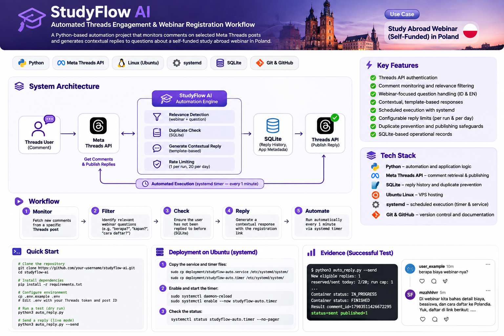
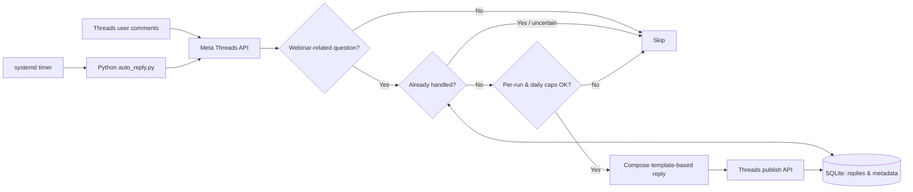

# StudyFlow AI

**Automated Threads Engagement for a Study Abroad Webinar**

[](https://www.python.org/)   

StudyFlow AI is a Python-based workflow that monitors replies to a designated Meta Threads post, identifies webinar-related questions, and publishes contextual, template-based responses through the official Threads API. It was developed as a practical Linux VPS automation project for a self-funded study-abroad webinar in Poland.

> **Project status:** A live reply was successfully published through the Threads API. The unattended systemd timer should be verified separately in deployment logs. This project currently uses **rule-based classification**, not a generative AI model.

## System architecture



*Illustrative project overview. The terminal and social media previews in the image are visual mockups, not independently verified screenshots. Actual validation evidence should be added separately.*



## Highlights

- **Comment ingestion:** Retrieves comments from a configured Threads post using the official API.
- **Question relevance:** Recognizes webinar and related registration, timing, eligibility, and cost questions, including selected short Indonesian questions.
- **Template-based responses:** Directs interested users toward the official webinar registration process.
- **Duplicate safeguards:** Uses SQLite to track comment processing, publish results, and uncertain outcomes requiring review.
- **Controlled publishing:** Configurable per-run and per-day limits (deployment target: **1 reply per scan** and **20 replies per day**).
- **Scheduling:** Ubuntu `systemd` timer intended to execute the publishing worker approximately once per minute.
- **Automatic cutoff:** Optional UTC timestamp stops publishing after the campaign period.

## Tech stack

| Component | Technology | Purpose |
|---|---|---|
| Automation | Python | Comment processing and reply logic |
| Integration | Meta Threads API | Read comments and publish replies |
| Database | SQLite | Reply history and metadata |
| Runtime | Ubuntu VPS | Always-on deployment host |
| Scheduling | systemd service and timer | Periodic unattended execution |
| Source control | Git and GitHub | Versioning and portfolio documentation |

## Repository layout

```text
studyflow-ai/
├── app.py
├── auto_reply.py
├── safe_ops.py
├── .env.example            # Safe template; never real credentials
├── .gitignore
├── README.md
├── deployment/             # Sanitized systemd units, if included
└── docs/
    ├── architecture.png
    └── evidence/           # Sanitized real screenshots, optional
```

## Configuration and local validation

1. Install the project's Python dependencies, if any, in a Python virtual environment compatible with the deployed runtime.
2. Copy the safe example configuration: `cp .env.example .env`.
3. Configure a valid Threads API token, target post ID, and SQLite path in `.env`. Do not commit `.env`.
4. Initialize the post baseline using the included `safe_ops.py` workflow before enabling publishing.
5. Perform a **dry run**:

   ```bash
   python3 auto_reply.py
   ```

6. Inspect the candidate reply and only then perform a **controlled live test**:

   ```bash
   python3 auto_reply.py --send
   ```

   This command can publish a public Threads reply. Only run it when intentional.

### Example configuration

```dotenv
THREADS_ACCESS_TOKEN=REPLACE_WITH_YOUR_TOKEN
THREADS_POST_ID=REPLACE_WITH_POST_ID
DB_PATH=data/studyflow.db
AUTO_REPLY_ENABLED=false
LIVE_MODE=false
AUTO_MAX_PER_RUN=1
AUTO_MAX_PER_DAY=20
AUTO_STOP_AT_UTC=REPLACE_WITH_FUTURE_UTC_TIMESTAMP
```

## Ubuntu scheduling

Deploy a reviewed, sanitized `studyflow-auto.service` that runs `auto_reply.py --send` with the correct Python interpreter and working directory. Deploy `studyflow-auto.timer` with `OnUnitInactiveSec=1min` and enable the timer using:

```bash
sudo systemctl daemon-reload
sudo systemctl enable --now studyflow-auto.timer
systemctl status studyflow-auto.timer --no-pager
sudo journalctl -u studyflow-auto.service -n 50 --no-pager
```

**Important:** `active (waiting)` confirms the timer is scheduled, **not** that a reply was published. Verify real delivery in Threads and inspect logs for `status=sent published=1`. Respect campaign cutoff, API permissions, platform rules, and rate limits.

To stop automatic execution:

```bash
sudo systemctl disable --now studyflow-auto.timer
```

## Validation evidence

A controlled test produced a successful publication status:

```text
Container status: IN_PROGRESS
Container status: FINISHED
Result comment_id=[redacted] status=sent published=1
```

For a public portfolio, add actual screenshots of a successful public reply and sanitized systemd logs under `docs/evidence/`. Redact tokens, private identifiers, and other users' personal data. Do **not** upload database files or production `.env` content.

## Known limitations and future improvements

- Current relevance detection is rule-based and can misclassify ambiguous comments.
- Reply availability and publishing depend on Meta API responses and permissions.
- Multi-post campaign handling should use post-scoped metadata and tests.
- Add unit tests and GitHub Actions CI, alerting, structured logs, and deployment automation before claiming a mature CI/CD pipeline.

## Responsible use

This project is an independent educational/portfolio implementation and is not endorsed by Meta. Run only on accounts you control and adhere to Threads platform policies.
